[Local only]{.badge-status}

::: {.content-hidden}
TODO: repo link, only if the repository is made public.

TODO: optional screen recording (under 15 s, muted, looping) of upload → progress → result,
with a poster frame.
:::

::: {.fact-strip}
[Runs 100% locally]{.fact} [~5 s per page]{.fact} [PDFs, scans, HEIC photos]{.fact}
[199 tests]{.fact}
:::

```{=html}
<figure class="ba-slider" style="--pos: 50%">
  <div class="ba-frame">
  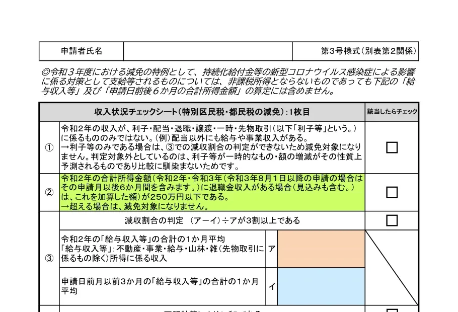
  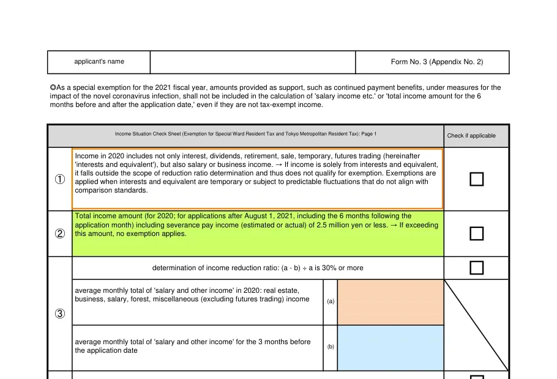
  <input type="range" min="0" max="100" value="50"
         aria-label="Drag to compare the Japanese original with the English output"
         oninput="this.closest('.ba-slider').style.setProperty('--pos', this.value + '%')">
  </div>
  <figcaption>Drag to compare: Japanese original (left), English output (right). A blank,
  publicly published Meguro City tax form.
  <a href="images/form-original-ja.webp">Full original page</a> ·
  <a href="images/form-accurate-en.webp">full English page</a>.</figcaption>
</figure>
```

## The problem

The main motivation is **privacy**. The documents I most need translated are government
paperwork: tax notices, residence forms and contracts, full of names, addresses and income
figures. Those are exactly the documents you shouldn't be uploading to
a cloud translator.

They're also hard to translate well. Japanese municipal paperwork is dense: tables, amounts,
era dates such as 令和3年, and legal thresholds where 以上 ("or more") and 未満 ("less than")
decide whether you qualify. Cloud translators flatten all of that into a wall of text and lose
the layout that tells you which box is which.

So I built a tool that translates them on my own Mac and writes the English back into the same
boxes, tables and coloured cells. MLX runs the translation models and Apple Vision does the OCR.
No document leaves the machine.

## Keeping the layout

For PDFs with a text layer, each block of text is extracted with its position, translated, and
written back in place. English is usually longer than Japanese, so text has to shrink to fit,
but blocks of the same size share one shrink factor, so a column of table cells doesn't end up
in five different font sizes. Fonts are subset to the characters actually used, which took the
output from 30 MB to about 1 MB.

## Not trusting the model with numbers

This is the decision the rest of the design hangs on: **the model never gets the final word on
a number.**

- Amounts, formulas, limits (以上, 未満, 超, 以下) and era years are converted **in code**,
  before the model sees the text or instead of it.
- Every translation is checked for changed numbers, operators, currency and glossary terms,
  and for Japanese left untranslated. A failed check is retried once.
- If it still fails, the block is **outlined in orange** in the output, so a person knows
  exactly where to look.
- An editable glossary of tax, legal and administrative terms follows the National Tax
  Agency's English terminology.

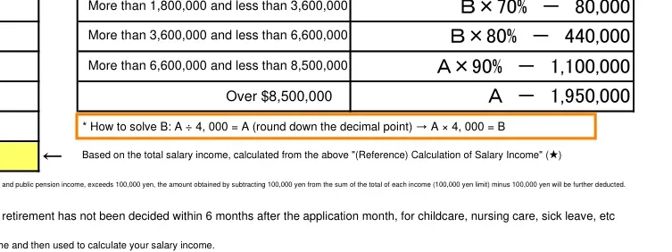{width="753" height="282" fig-alt="A close crop of a translated table row with an orange outline around a line explaining how to calculate B" loading="lazy"}

## Scans and phone photos

Pages without a text layer go through Apple Vision OCR. The OCR lines are regrouped into
paragraphs, and the grouping respects table rules and changes in cell colour, so text from
neighbouring cells doesn't merge. The original text is then painted over with the sampled paper
colour, or white text on dark cells, before the English goes on.

Phone photos needed one more step, and this image shows why:

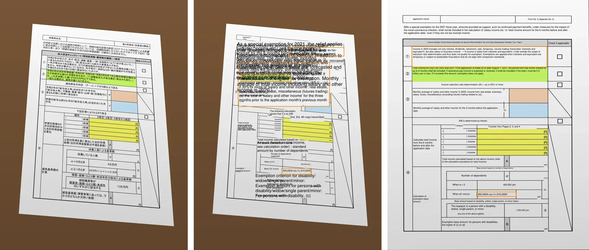{width="1800" height="765" fig-alt="Three versions of the tax form: an angled photo, a translation of it with English overlapping in a tangle, and a clean translation after the page was straightened" loading="lazy"}

Translated as taken, the boxes are skewed and the English lands on top of itself. So Vision
first finds the page and a perspective warp flattens it, and detections without a visible page
edge are rejected rather than warped. Sideways or upside-down photos and scans are turned
upright from the direction the text reads, and translated boxes are trimmed apart so the
English never overlaps.

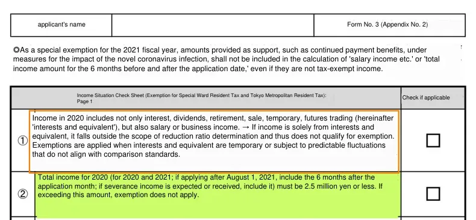{width="790" height="365" fig-alt="The top of the scanned form in English, with the same table rows and the orange check outline" loading="lazy"}

It works beyond forms, too. These are my own photos of public material, and they're good
examples rather than typical results:

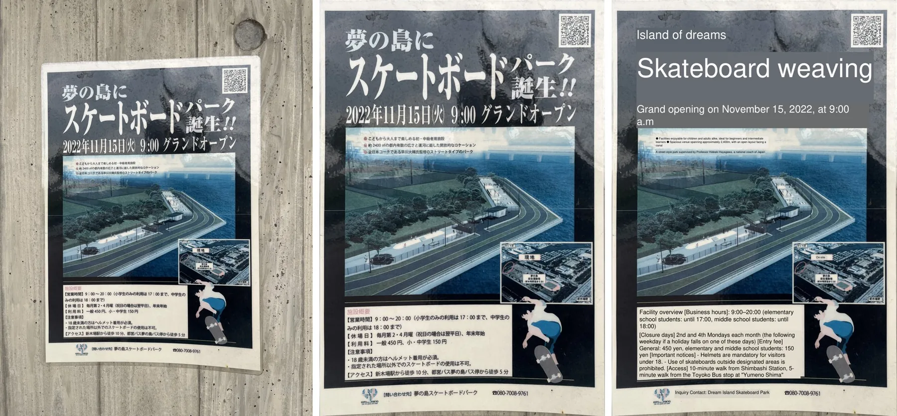{width="1800" height="836" fig-alt="A skate-park opening poster photographed at an angle on a wall, the straightened poster, and the English version with the same layout" loading="lazy"}

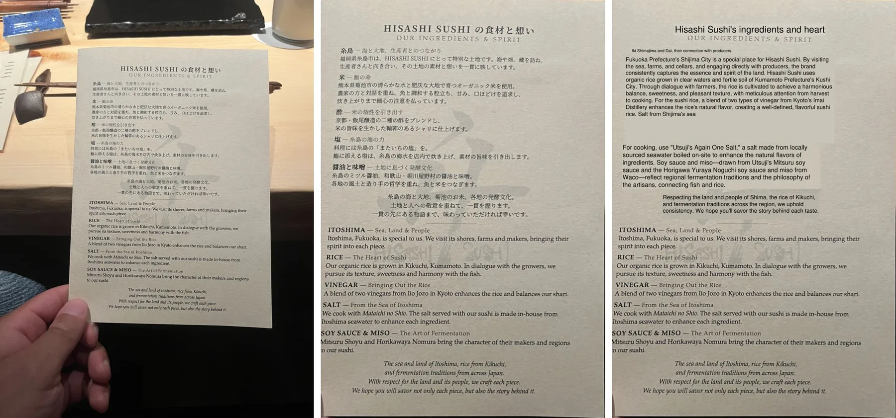{width="1800" height="841" fig-alt="A sushi restaurant's menu card photographed in hand, straightened, and with the Japanese paragraphs translated while the printed English stays unchanged" loading="lazy"}

The pipeline, end to end:

```{mermaid}
flowchart TB
  A["PDF or photo<br/>(photos: rotate upright,<br/>straighten, downscale)"] --> C{"Text layer?"}
  C -- yes --> D["Extract positioned blocks"]
  C -- no --> E["Apple Vision OCR,<br/>group lines by table rules<br/>and cell colours, paint over"]
  D --> F["In code: era dates,<br/>amounts, limits, formulas"]
  E --> F
  F --> G["MLX model + glossary"]
  G --> H{"Checks pass?"}
  H -- "no: retry once,<br/>then orange outline" --> I
  H -- yes --> I["Trim boxes apart, write English back,<br/>subset fonts → PDF"]
```

## Two models, an explicit trade-off

There are two local models, and the app says plainly what each one costs you:

- **Accurate:** Qwen3-4B, about 5 s per page, uses the glossary. For forms and contracts.
- **Fast:** LFM2-350M, a dedicated English–Japanese translation model, about 2 s per page,
  with rougher output. Fine for leaflets and quick previews.

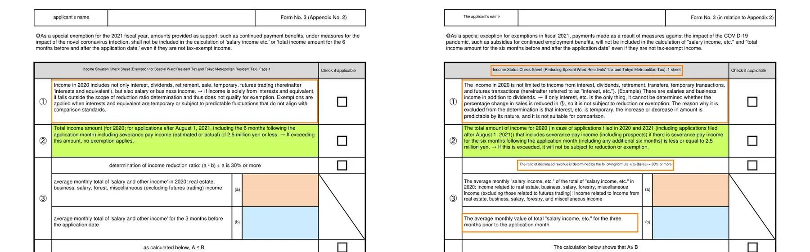{width="1800" height="560" fig-alt="Two English versions of the top of the form side by side; the right one has more orange outlines and different wording" loading="lazy"}

Timings are approximate, measured on my Mac. [Full pages](images/models-accurate-vs-fast.webp).

## Private by design, even on a phone

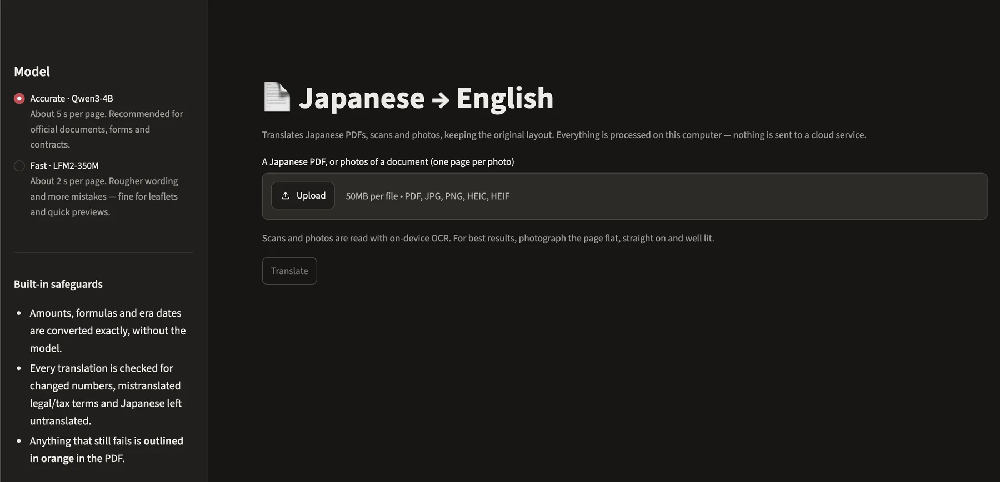{width="1800" height="869" fig-alt="The app's dark web interface with a model picker, a list of built-in safeguards and an upload box, noting that nothing is sent to a cloud service" loading="lazy"}

The Streamlit web UI only listens on `127.0.0.1`. To use it from my iPhone,
`japanese-pdf-reader-phone on` shares it over Tailscale Serve with my own devices only, and it
**refuses to run while Tailscale Funnel** is on.
`off` is a kill switch that removes the sharing again.

::: {.phone-pair}
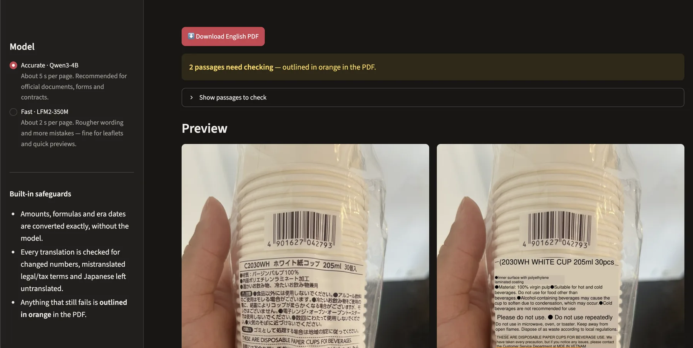{width="1800" height="906" fig-alt="The result screen: a download button, a notice that 2 passages need checking, and a paper-cup package in Japanese next to its English translation" loading="lazy"}

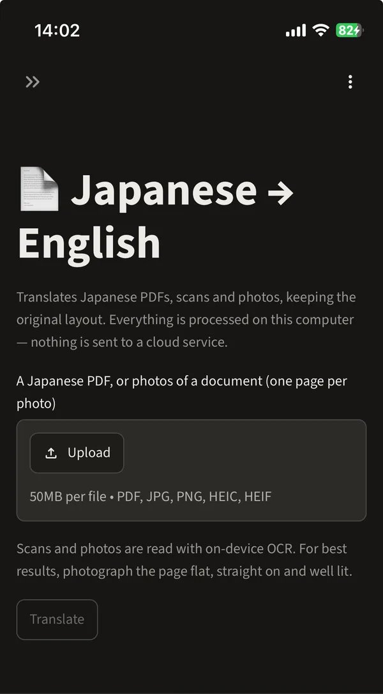{width="600" height="1086" fig-alt="The app's upload screen on an iPhone" loading="lazy"}
:::

## How it was built

Test-driven throughout, red-green-refactor: 199 fast tests, plus slow tests that run the real
models when I ask for them, in 44 small commits. Python 3.12 with uv, PyMuPDF for the PDFs,
Pillow and pillow-heif for photos, MLX-LM for the models, Apple Vision through PyObjC and
ocrmac, and Streamlit for the UI.

## Limits

- It's a reading aid, not a certified translation. Check anything outlined in orange, and
  anything that matters.
- OCR sometimes misses isolated single characters and can misread maths symbols: on the scan
  above, A≦B further down the page came out as "AIB".
- Vertical text (tategaki) and handwriting aren't supported.
- It needs an Apple Silicon Mac, for MLX and Apple Vision.
